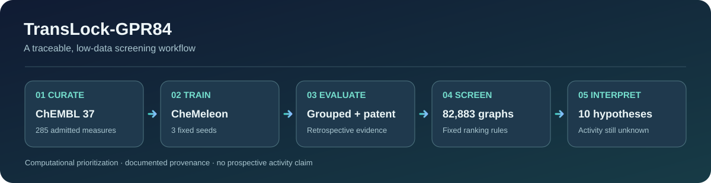

<div align="center">



# TransLock-GPR84

**Traceable molecular screening for GPR84 in a low-data setting**

[English](README.md) · [简体中文](README.zh-CN.md) · [Model card](models/Model_Card.md) · [Methods](docs/methods.md)

</div>

TransLock-GPR84 is a computational research project for prioritizing GPR84 small-molecule hypotheses. It curates public activity measurements, fine-tunes a [CheMeleon](https://doi.org/10.1021/acs.jcim.6c01546) molecular graph model, evaluates it across publication groups and one external patent series, and applies a fixed ranking procedure to a public molecular catalogue. The repository contains the research code, compact source and development tables, selected results, and the information needed to locate larger resources.

> **Research status:** The ten nominated molecules have no confirmed GPR84 activity or antagonist effect. The external evaluation is retrospective and comes from one patent series. Short molecular dynamics simulations support structural interpretation only.

## At a glance

| Stage | Recorded outcome |
|:--|:--|
| Data curation | ChEMBL 37: 2,070 source activity records → 285 admitted measurements → 277 assay-level units → 248 encoded graphs, across 6 publications and 17 assay systems |
| Internal development | Mean top-20% enrichment factor (EF): fine-tuned **1.112**, frozen encoder **1.016**, fingerprint similarity **1.083**. These comparisons informed method selection. |
| Catalogue application | 100,000 source records → **82,883** distinct scored molecular graphs → **10** scaffold-filtered hypotheses |
| External retrospective evaluation | 61 measured compounds from [WO2024028364A1](https://patents.google.com/patent/WO2024028364A1/en): the fixed primary model selected **12 strong compounds in the top 13**, versus **10** for the similarity reference. ROC-AUC: **0.646** versus **0.401**. |
| Short MD analysis | Two nominated compounds and the GLPG1205 reference, each with three 5 ns membrane replicas: **9 trajectories / 45 ns** in total. |

The external set contains 53 strong and 8 weaker compounds; random selection would include about **11.30** strong compounds in 13 picks. The 61-compound and 60-connection analyses, all three predetermined model seeds, and the full scope of this result are described in [evaluation](docs/evaluation.md). This evidence does not measure the ten nominations.

## What is here

```text
src/translock_screening/   curation, grouped evaluation, training, screening and analysis
scripts/                   documented research entry points
configs/                   frozen parameters and study protocols
data/source/               compact ChEMBL 37 source records and provenance
data/training/             admitted measurements, units and held-out membership
results/                   selected development metrics, external summary and nominations
tests/                     focused behavior checks
docs/                      methods, reproduction and resource guidance
models/Model_Card.md       model architecture, intended use and limitations
```

The original competition submission is preserved separately. This GitHub edition selects research materials that can be shared and read in a source repository. Large model files, the complete 100,000-record catalogue, docking poses, MD trajectories, and licensing-pending patent transcriptions are outside Git history; see [resources](docs/resources.md).

## Get started

The recorded computational environment was **WSL2 Ubuntu 22.04, Python 3.11 and uv**. The root lockfile describes the main CheMeleon environment and pins a CUDA build of PyTorch. A fresh public checkout has not yet been validated on every device.

```bash
git clone https://github.com/tail258/TransLock-GPR84.git
cd TransLock-GPR84
uv sync --frozen
```

You can inspect the included [training-unit table](data/training/training_units.csv), [internal development results](results/internal_development/), [external aggregate metrics](results/external/metrics.csv), and [ten candidate hypotheses](results/screening/candidate_hypotheses.csv) without downloading model weights. The included data contain no team-generated wet-lab measurements.

The fixed full-catalogue commands are `govern.py`, `train.py`, `predict.py`, `screen.py`, and `main.py`. They use different resource sets. [Reproduction](docs/reproduction.md) specifies required inputs and the validation status of each entry point. For real inference with the [`examples/`](examples/README.md) input, place the three states from the [v0.1.0 model release](https://github.com/tail258/TransLock-GPR84/releases/tag/v0.1.0) in `models/` and the [author's pretrained checkpoint](https://doi.org/10.5281/zenodo.15460715) in `models/pretrained/`.

## Evidence and boundaries

- Publication-group internal comparisons are development results; they are not an independent test set.
- The external ranking uses one patent-reported GPR84 antagonist series. The model and ranking rule were fixed before scoring it, while its labels were already known. It does not establish broad superiority across chemical series.
- The model returns a **raw, uncalibrated logit** for ranking. It is not a predicted IC50 or a probability of activity.
- Scaffold diversity, docking poses and 5 ns MD replicas generate hypotheses and structural context. They do not establish experimental activity, antagonist direction, binding free energy, selectivity or safety.

Read the [model card](models/Model_Card.md), [methods](docs/methods.md), and [evaluation](docs/evaluation.md) before interpreting individual scores.

## Provenance and reuse

Data sources and their terms are listed in [data/README.md](data/README.md). Third-party code and the CheMeleon checkpoint are documented in [THIRD_PARTY.md](THIRD_PARTY.md); their original notices are in [`licenses/`](licenses/). The project has not yet declared a license for its own code, so public visibility should not be taken as a grant of reuse rights. Please cite the upstream papers and datasets shown in [references](docs/references.md) when using the methods or data.

**Project language:** English documentation is the default. A matched [Chinese README](README.zh-CN.md) is maintained for readers of the original research records.
